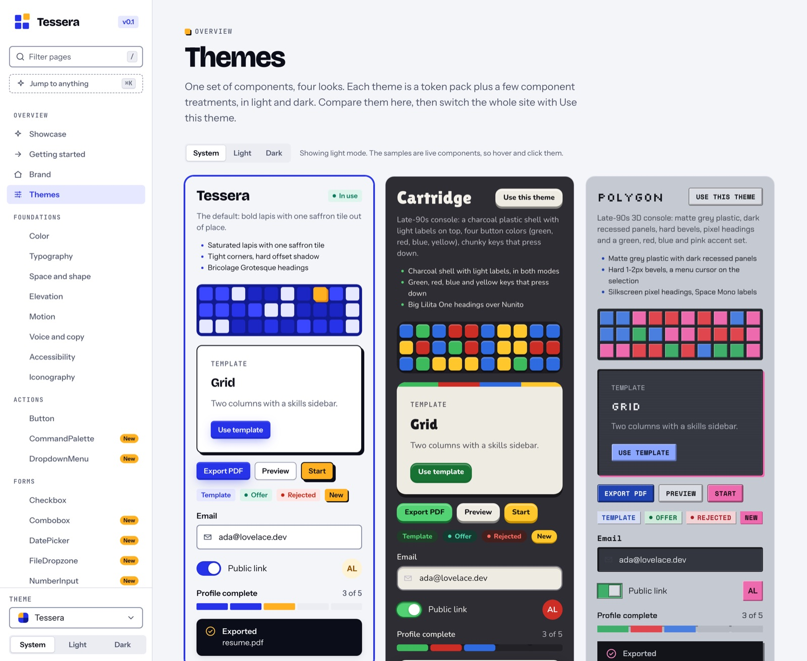
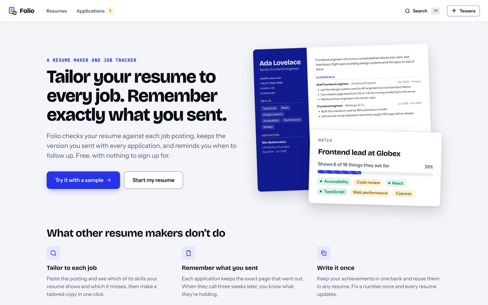

# Tessera

**A tile-built design system and React component library, and Folio, a real app built on it.**

[**Docs**](https://jwag789.github.io/tessera/) · [**Folio demo app**](https://jwag789.github.io/tessera/folio/) · [**Themes**](https://jwag789.github.io/tessera/#themes) · [Getting started](https://jwag789.github.io/tessera/#start)

[](https://www.npmjs.com/package/@tessera-design/react)
[](https://github.com/jwag789/tessera/actions/workflows/ci.yml)
[](https://jwag789.github.io/tessera/)


[](https://jwag789.github.io/tessera/#themes)

- **40 React components**, typed, tested and keyboard-accessible: from Button and Select to Command palette, Date picker, Data table and Drawer, plus layout primitives.
- **Twelve themes** (Tessera, Atelier, Cartridge, Polygon, Gloop, Shonen, Jelly, Neon, Static, Lagoon, Clay and Cutout), each in light and dark, built from one set of design tokens. Switch them live in the docs.
- **154 tests**, with axe accessibility checks on every component, strict TypeScript, and a bundle size budget enforced in CI.
- **Folio**, a resume builder and job tracker that uses nearly every component, to show the system holding up in a real product.

## Folio: the system in a real app

[](https://jwag789.github.io/tessera/folio/)

[**Open Folio**](https://jwag789.github.io/tessera/folio/) and press **Try it with a sample**. No sign-up; everything stays in your browser.

- **Tailors your resume to each job:** paste a posting and see which of its skills your resume shows and which it misses, then make a tailored copy in one click.
- **Remembers what you sent:** every application keeps the exact page that went out, with follow-up reminders and a coming-up calendar.
- **Built only from Tessera:** the editor, tracker, command palette, toasts, dialogs and every theme come from the library. The source is in [`apps/resume`](apps/resume); optional sign-in and saving use Supabase ([setup](apps/resume/SETUP.md)).

## What's in the repo

| Path | What it is |
| --- | --- |
| [`packages/tokens`](packages/tokens) | `@tessera-design/tokens`: `tokens.json` and theme packs, built into CSS variables for both modes and a typed JS export |
| [`packages/react`](packages/react) | `@tessera-design/react`: the components, one stylesheet, theme treatments and the shared positioning layer |
| [`apps/docs`](apps/docs) | The docs site: a live example, usage, guidelines and a generated props table for every component |
| [`apps/resume`](apps/resume) | Folio, the demo app |

It's one npm workspace, so the docs and Folio build against the component source, and a change to a component shows up in both.

## Use it

```bash
npm install @tessera-design/react
```

[`@tessera-design/react`](https://www.npmjs.com/package/@tessera-design/react) brings [`@tessera-design/tokens`](https://www.npmjs.com/package/@tessera-design/tokens) with it; install the tokens on their own to use the CSS variables without React. Both are published from GitHub Actions with [npm provenance](https://docs.npmjs.com/generating-provenance-statements).

```tsx
import '@tessera-design/react/styles.css'; // tokens + component styles
import '@tessera-design/react/fonts.css';  // optional: Bricolage Grotesque, Instrument Sans, JetBrains Mono
import { Button, Card, ToastProvider } from '@tessera-design/react';

export function App() {
  return (
    <ToastProvider>
      <Card variant="tile" eyebrow="Most picked" title="Grid" actions={<Button>Use template</Button>}>
        A two-column layout with a skills sidebar.
      </Card>
    </ToastProvider>
  );
}
```

The bundle starts with `"use client"`, so it works from React Server Components in the Next.js App Router.

### Themes

Tessera ships twelve themes, each in light and dark:

- **Tessera** (the default)
- **Atelier:** editorial and quiet, for studios and portfolios, with warm bone paper and near-black ink, light serif titles, small spaced capitals on keys, hairlines instead of shadows and one terracotta accent; a gallery wall after dark
- **Cartridge:** a late-90s 64-bit console, where cards are cartridges, keys carry A, B and C prompts, the mosaic is a 3D stage floor and text boxes blink their way on
- **Polygon:** matte grey plastic, dark recessed panels, hard bevels and pixel headings
- **Gloop:** 90s kids-TV, with slime green and orange, thick outlines, and everything a bit tilted
- **Shonen:** a manga page, black ink on newsprint with one red spot color, with comic panels, screentone, speech bubbles and focus lines
- **Jelly:** Y2K candy plastic, see-through and glossy in fruit flavors, with gel keys, virtual-pet LCD fields and a heart meter
- **Neon:** 80s sci-fi, a black grid world lit in cyan with an orange rival, glowing Orbitron titles, HUD corner brackets, light trails, terminal fields and glowing ring avatars
- **Static:** early-2000s alt rock, a sketchbook by day and a sprayed concrete wall after dark, with stencil type, duct-taped pages, glitching keys, label-maker tape, a VU meter and an equalizer
- **Lagoon:** an early-2000s JRPG island, a sunlit beach by day and a starlit tide with drifting fireflies after dark, with blue gradient menu windows and a pointing-glove cursor, glossy gel keys, a gold-framed featured card, element-orb avatars and an overdrive gauge
- **Clay:** playdough, with everything a soft matte lump of clay in toy-box colors, clay grain and thumbprints, lumpy hand-rolled shapes, keys that wobble and squish, pressed-in fields, a rolled clay snake for progress and bouncing clay balls
- **Cutout:** construction paper and scissors, like a cutout cartoon, with fibrous paper in flat colors, a paper sky over snowy paper hills (or a paper moon and stars after dark), scissor-cut corners, crooked sheets with hard little shadows, chunky cut-out titles, and keys and cards that move a frame at a time

Import a theme's CSS and pick it with `ThemeProvider`:

```tsx
import '@tessera-design/react/themes/cartridge.css';
import '@tessera-design/react/themes/cartridge-fonts.css';

<ThemeProvider defaultBrand="cartridge" storageKey="theme"><App /></ThemeProvider>
```

A theme is a token file in `packages/tokens/themes/` plus optional component treatments in `packages/react/src/themes/`, built into one CSS file scoped to `[data-brand="name"]`. Treatments use CSS `@scope`, so themes can sit side by side on one page.

Dark mode follows the system setting. `ThemeProvider` lets people choose and remember it (`storageKey`), override tokens (`tokens={{ lapis: '#0f766e' }}`), or theme one subtree (`scope="local"`). Without React, set `data-theme` and `data-brand` on any element.

## Components

| Group | Components |
| --- | --- |
| Actions | Button, DropdownMenu, CommandPalette (+ `useHotkey`) |
| Forms | TextField, Textarea, Select, Combobox, DatePicker (+ Calendar), NumberInput, Slider, SegmentedControl, TagInput, FileDropzone, Checkbox, RadioGroup, Switch |
| Navigation | Navbar, SidebarNav, Tabs, Breadcrumbs, Pagination, Stepper |
| Layout | Stack, Inline, Grid, Container, Divider, Card, Accordion |
| Data | Table (sorting, selection, sticky header) |
| Status | Badge, Avatar (+ AvatarGroup), Kbd |
| Feedback | Alert, Toast (+ ToastProvider, `useToast`), Progress, Skeleton, Spinner, EmptyState |
| Overlays | Dialog, Drawer, Popover (+ Floating), Tooltip |
| Theming | ThemeProvider (+ `useTheme`) |
| Brand | Mosaic, Icon |

Popover, DropdownMenu, DatePicker and Tooltip share one positioning layer (`Floating`): portal, flip when there's no room, shift to stay on screen, follow scroll and resize, and animate in from the side they open on.

## Develop

```bash
npm install
npm run dev          # docs at http://localhost:5174, live against the component source
npm run dev:resume   # Folio at http://localhost:5173
npm test             # library and Folio tests, including axe accessibility checks
npm run typecheck
npm run build        # tokens, the React package, the docs and Folio
npm run size         # gzipped bundle size against the budget in packages/react/package.json
```

Tokens live in `packages/tokens/tokens.json`; edit them there and rebuild. Component styles are in `packages/react/src/styles.css` and use only token variables. Each component's guidelines are in `apps/docs/src/content/<Component>.md`, and its live example and usage snippet are in `apps/docs/src/demos.tsx`. The props tables are generated from the TypeScript types (`apps/docs/scripts/gen-props.mjs`), so documenting a prop means writing a `/** comment */` on it.

### Quality gates

- **Accessibility:** every component runs through axe-core in `packages/react/test/a11y.test.tsx`. Keyboard behavior (menus, comboboxes, the date grid, focus traps) is covered by the behavior tests.
- **Bundle size:** CI fails if the gzipped JS or CSS grows past its budget.
- **Types:** strict TypeScript across the packages, the docs and Folio.

### Releasing

Changes to the packages get a changeset: run `npx changeset`, choose the bump and write one changelog line. `@tessera-design/tokens` and `@tessera-design/react` always release together at the same version.

Releases are automated by `.github/workflows/release.yml`. When changesets land on `main`, it opens a **Version packages** pull request that bumps versions and writes the CHANGELOGs; merging that pull request typechecks, tests, builds and publishes both packages to npm with [provenance](https://docs.npmjs.com/generating-provenance-statements). It needs an npm automation token in the `NPM_TOKEN` repository secret.

## Deploy

`.github/workflows/docs.yml` builds the docs and Folio and publishes both to GitHub Pages on every push to `main`: the docs at `/tessera/`, Folio at `/tessera/folio/`. `ci.yml` runs typecheck, tests, the build and the size check on every push and pull request.

## License

MIT © Justin Wagner
